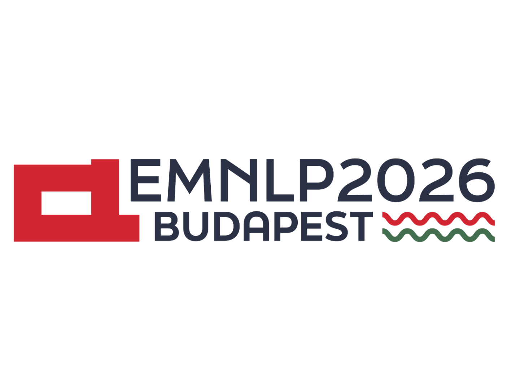
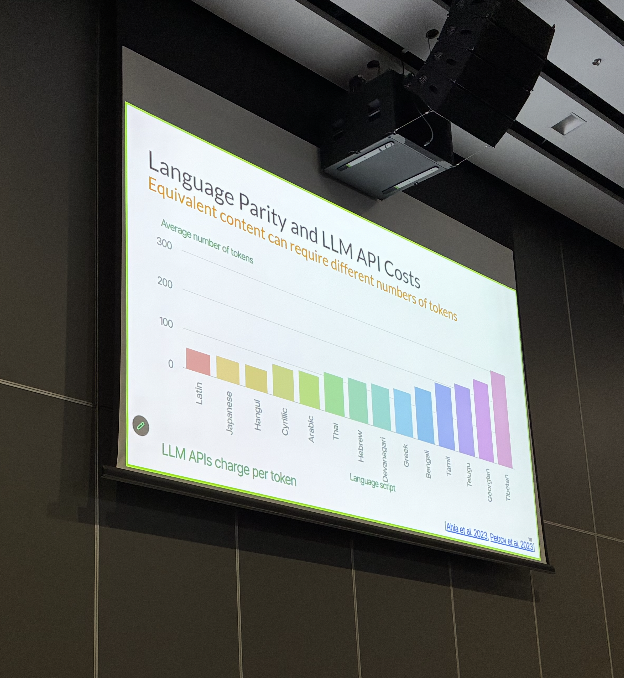
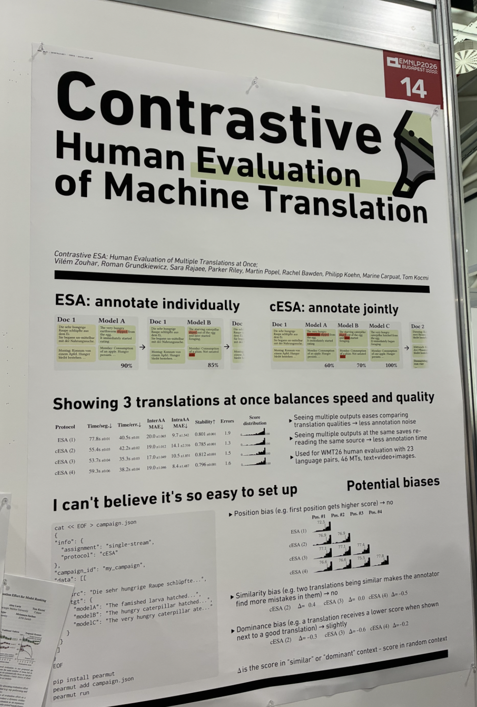

# EMNLP 2026 Tutorial and Workshop

- **Official Date**: October 24-29, 2026
- **Location**: Budapest, Hungary
- **My Attendance Date**: October 27-29, 2026

---

## 0. 학회 소개

### 0.1. EMNLP란?

- EMNLP(Empirical Methods in Natural Language Processing): 자연어처리(NLP)를 다루는 국제 학술대회
- 그 중 ‘Empirical Methods’는 '실제 데이터와 실험을 바탕으로 방법의 효과를 확인한다는 의미' 
- 연구 주제 [EMNLP 공식 연구 주제 안내](https://2026.emnlp.org/calls/main_conference_papers/)
    - 새로운 AI 기술 제안 (기술이 어떤 상황에서 잘 작동하는지 또는 오류가 발생하는지 확인 + 기존 방법보다 무엇이 개선되었는지를 검증해 공유)
    - AI의 답변을 얼마나 믿을 수 있는지 
    - 실제 업무에 어떻게 활용할 수 있는지
- EMNLP에는 최신 연구 성과를 발표하는 본 학회(Main Conference)와 함께 Tutorial과 Workshop 프로그램이 마련되어 있음
    - 본 학회 + Tutorial/Workshop --> Full
    - Tutorial/Workshop only --> 할인
    - 나는 중간고사 기간 issue로 인해 이틀짜리 tutorial/workshop only만 신청함

### 0.2. Tutorial: 특정 주제를 체계적으로 배우는 집중 강의

- Tutorial: 특정 연구 주제의 배경과 핵심 방법을 전문가에게 배우는 집중 강의
- 해당 주제가 왜 필요한지, 지금까지 어떤 방법이 개발되었는지, 앞으로 어떤 문제가 남아 있는지를 연결하여 설명
- 개별 논문만으로 파악하기 어려운 전체 흐름을 이해하는 것이 목적
- [EMNLP 공식 Tutorial 안내](https://2026.emnlp.org/calls/tutorials/)
- [Tutorial 프로그램](https://2026.emnlp.org/program/tutorials/)

### 0.3. Workshop: 공통의 관심사를 깊이 논의하는 주제별 학술 모임

- Workshop: 특정 주제에 관심이 있는 연구자들이 모여 연구 결과를 공유하고, 해결해야 할 문제를 집중적으로 논의하는 모임의 장
- 이번 EMNLP에서는 '저자원언어 기계 번역', '번역 결과 오류 자동 검수' 등의 주제가 workshop으로 제시되었음
- 보통 workshop session마다 포스터를 걸어 놓고 지나다니는 사람에게 자신의 연구를 설명
- [EMNLP 공식 Workshop 안내](https://2026.emnlp.org/program/workshops/)

## 1. 참석 목적

- **지난 연구와의 관련성**: LLM-based Machine Translation Evaluation
- **앞으로의 연구와의 관련성**: Neuro Symbolic World Model (LLM의 prior knowledge를 이용하여 world model 그 자체, 혹은 월드모델에서 활용하는 agent의 behavior를 symbolic하게 모델링)
- **참석 목적**: 
    - 내 연구 포스터 발표
    - 지난 연구 도메인 리뷰, 앞으로의 연구와의 관련성 검토
    - 네트워킹 및 영감

## 2. Tutorial - Tokenization for LLM

- 'Korean'이 아닌 'Hangeul'로 표기
- 생각보다 토크나이제이션에 효율적인 한글

## 3. Workshop

- 매우 많은 워크숍 종류와 포스터 발표가 있었지만, 그 중 흥미롭게 남았던 것만 추림

### 3.1. Contrastive Human Evaluation of Machine Translation

- 매우매우 팬이던 Vilem Zouhar 님을 만남
- 제 논문의 gold label이 되었던 데이터들을 효율적으로 생산해내는 방법에 대한 연구

### 3.2. CLARE: A Criminal-Law DSL for Neuro-Symbolic Long-Form Legal Reasoning

- 우리나라 경찰청에서 경찰 분들을 서울대 대학원에 보내 방법론 연구
- LLM을 이용하여 법에 관한 open-ended facts로부터 -> explicit, reproducable한 legal structure 생성 (Neuro-symbolic)

### 3.3. KUEST: Korean Game Usage Evaluation Suite for LLM Translation

- 개인 한국인 팀 연구
- 게임 도메인에서의 번역 연구 (고려해야 할 것이 타 도메인보다 특수함: 말풍선 크기 안에 들어가느냐 등)
- 게임 코스프레를 하고 오셔서 매우 눈에 띄었음

### 3.4. In-Context Learning for Upper Sorbian to German Translation: Comparing Lexical and Morpho-Synthactic Information

- 뮌헨 공대
- 언어학적 레이블을 제공했을 때 독일어 -> 저자원 언어에서 무엇이 도움이 되는가에 관한 연구
- 독일어 언어학적 지식이 이해하는데 도움이 됨
- 저자원 언어 번역에 있어서 data-driven 보다 이런 언어학적 관점을 더 도움이 될 수도 있겠단 생각이 들었음

## 4. 종합 시사점

- **종합 시사점**: LLM based MT가 보동 oversatuated됐다고 말이 나오는데, 사실 저자원 언어, 특정 도메인 등에서는 아직 연구할게 많이 남았다. 
- **기타**: 
    - 연구에 자부심을 갖고, 동양 특유의 '겸손함'을 버리고 '공격적으로 어필'하는 태도를 배워야함
    - 세계적 행사인만큼 다양성에 대한 고려가 많이 되어있음 --> 급식 바이브코딩 프로젝트에 영감

