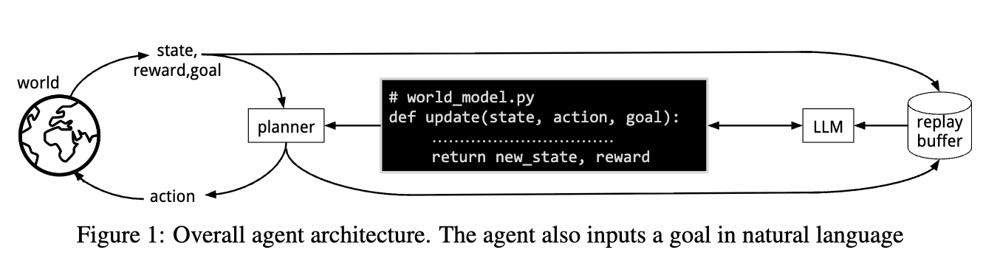
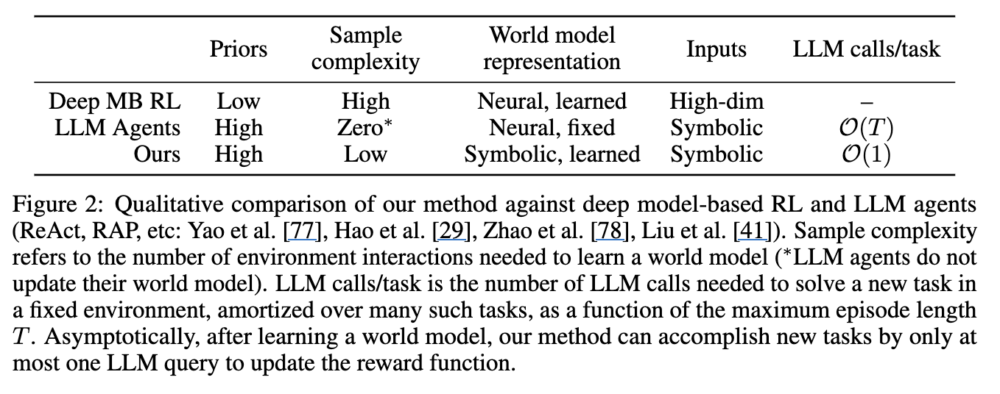

# WorldCoder, a Model-Based LLM Agent: Building World Models by Writing Code and Interacting with the Environment

- **저자**: Hao Tang, Darren Key, Kevin Ellis
- **arXiv**: https://arxiv.org/abs/2402.12275
- **Submission Date**: Sep 2024
---

## Introduction

- 보통 사람들은 새로운 기기를 다룰 때 그 사람이 갖고 있는 prior knowledge를 바탕으로 few interaction을 통해 해당 기기에 대해 배울 수 있다.
    - 이렇게 배운 'knowledge'는 ...
        - can achieve novel goals
        - can be transferred to similar devices
        - can be communicated symbolically to other people
    - 그렇다면 AI도 사람처럼 그렇게 할 수 있지 않을까?란 물음에서 출발

- *transition function*
    - 위 물음을 world model을 학습시키는 것으로 발전시킴
    - transitino fuction은 주어진 current state와 action을 갖고 next state of affairs를 mapping한다
    - 이 논문에서 이걸 해내는건 **Python program**

- world models 효능: allows reasoning in radically new situations 
    - by spending more time planning different actions
    - by accomplishing novel goals by just changing the reward function

- 그 와중에 world model을 LLM-generated code로 representing 하는 건 또 장점이 있음:
    - allows prior world knowledge embedded in the LLM to inform code generation
    - allows sample-efficient transfer across tasks by reusing pieces of old programs
    - allows auditing the system's knowledge (because programming languages are designed to be human-interpretable)

- 하지만 steep engineering challenges도 물론 있음
    - Agent의 past experience를 설명하는 transition fuction을 찾아야하는데
    - 그런 experience를 찾는게 efficient exploration을 필요로 함 -> long horizon task with sparse reward 환경에서 어려움

- 위 challenge를 극복하기 위하여 논문에서는 새로운 learning object를 제시
    - prefers world models which a planner thinks lead to rewarding states (particularly when the agent is uncertain as to where the reward are)
    - 이러한 program search problem address하기 위해 **curriculum learning**이 environment들 사이에서 knoweldge를 transfer할 수 있음을 보임

- 아래: overall architecture - Model-Based RL (MBRL)

- 아래: deep RL 과 LLM agents를 baseline으로 하여 비교한 것

- 핵심: 이 논문에서 LLM은 "world를 simulate 하는 것"이 아니라, "simulation of world를 build 하는 것"
    - 참고) ReAct와의 비교 - LLM agents는 world model rold을 reasoning about actions and consequenses하는 것으로 수행함
- 또한 이 논문에서 LLM은 planning을 수행하는 것이 아닌 "how the world *might* be인 fuzzy prior knowledge를 posses 함"으로서 programming과 debugging을 함

- Three main contributions
    1. World Coder architecture를 통해 world models를 code로 배움. 그리고 다른 baseline들보다 more transferable, interpretable, and dramaticaaly more sample-efficent
    2. A new learing objective for program-structured world models that favors *optimism in the face of world model uncertatinty*. 이 새 learning objective는 goal-driven exploratory behavior를 생성하며, 이는 상당한 양의 environment interaction 필요를 줄일 수 있음
    3. An analysisn of different forms of transfer of world models, finding that code can quickly adapted to new world dynamics within grid-world and robot task planining domains.

## Methods

### Problem statement and core representations

- Start with standard Markov Decision Process (MDP) but modify in three ways. 
    1. Assume that a goal is given in natural language
    2. Restrict ourselves to deterministic enviroinments and assume that environment dynamics are fixed across goals
    3. Assume an episodic MDP with the current episode terminating upon reaching the goal

- 이러한 formalization은 **Contextual Markov Decision Process (CMDP)**로 정의
    - CMDP  = tuple (C,S,A,M)
    - C: set of contexts (i.e. goals)
    - S: set of states (set of objects: each with a string-valued field "name" + fields "X, Y" (position) + additional fields depending on the object type)
    - A: set of actions
    - M(c): function mapping a context c to MDP
        - 이때 M(c) = (S,A,T,${R^c, \gamma}$)
        - T: transition function (T: S X A -> S) -> context에 영향 받지 않음
        - ${\gamma}$ : discount factor
        - ${R^c}$ : reward function (R^c: S X A X S -> R)

- Object: to select actions to maximize **cumulative discounted future rewards**
- Termination: modeled by assuming there is a special absorbing state.

- Representing world models as code: The agent uses Python code to model the transition and reward functions
    - 수학적으로 표현하면: tuple ${(\hat{T}, \hat{R})}$
        - $\hat{T}$ : S X A -> S
        - $\hat{R}$ : C -> (S X A X S -> R X {0,1})
            - 이 때 boolen은 goal reach 여부 (episode terminate 여부)

### The world model learing problem

- 우리가 잘 알고있는 standard training objective within model-base RL: the learned world model should explain the observed data by correctly predicting the observed state transitions and rewards

- 추가로: Optimisiom under Uncertatinty
    - 아직 규칙을 정확히 모른다면, 지금까지 관찰한 사실과 모순되지 않는 한 목표 달성이 가능하다고 가정하는 "낙관적인 (optimistic)" World Model을 선택한다

- Agent는 past environment interactions로부터 dataset D를 모음. 
- 또한 initial state ${s_0}$ 와 context of each episode ${c}$ 도 모음 -> so that it can prefer world models that can reach the goal from an initial state
 
### Understanding optimism under uncertainty

### Overall architecture

### Program synthesis via refinement

## Experimental Results

## Related Work

## Limitations and Open Directions