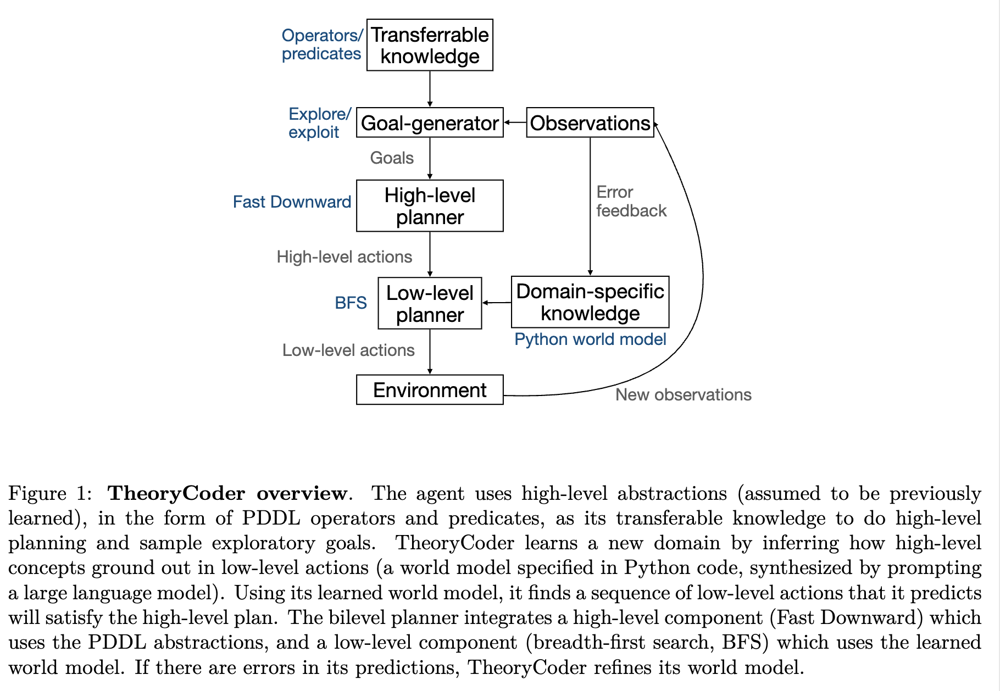
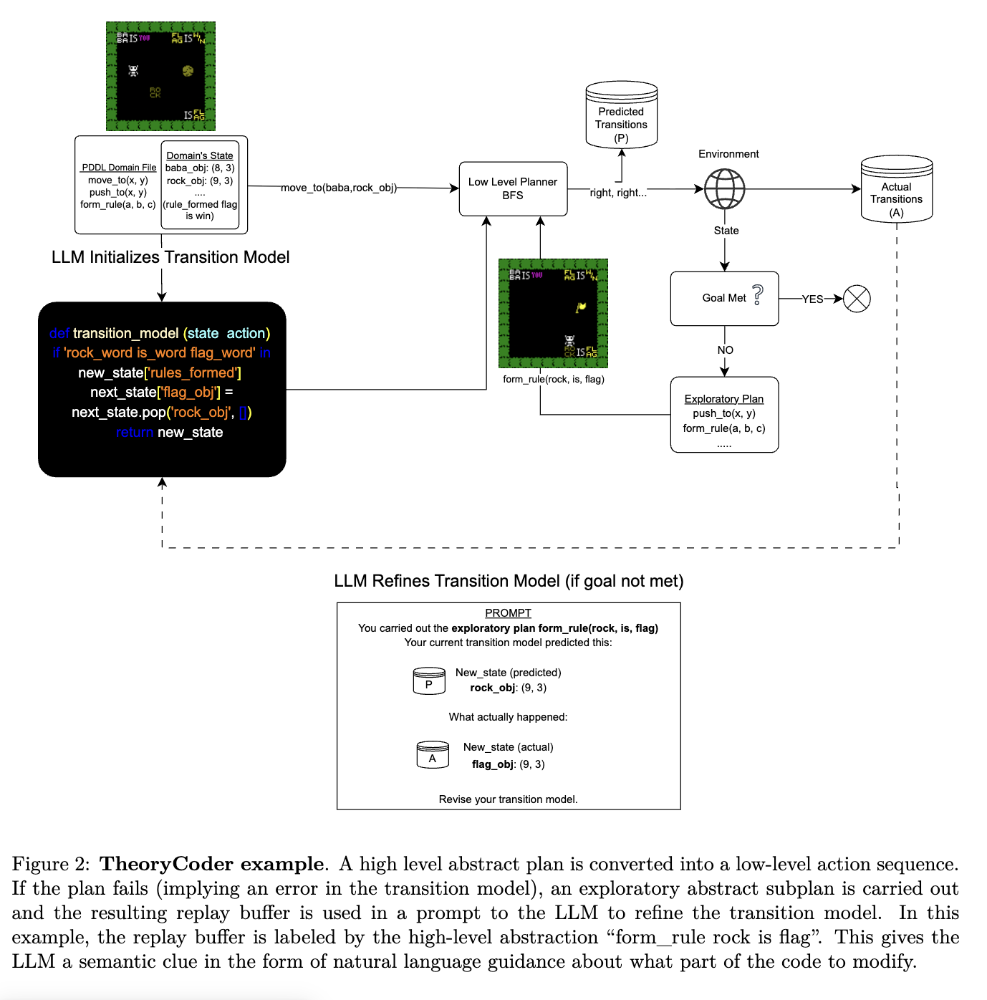
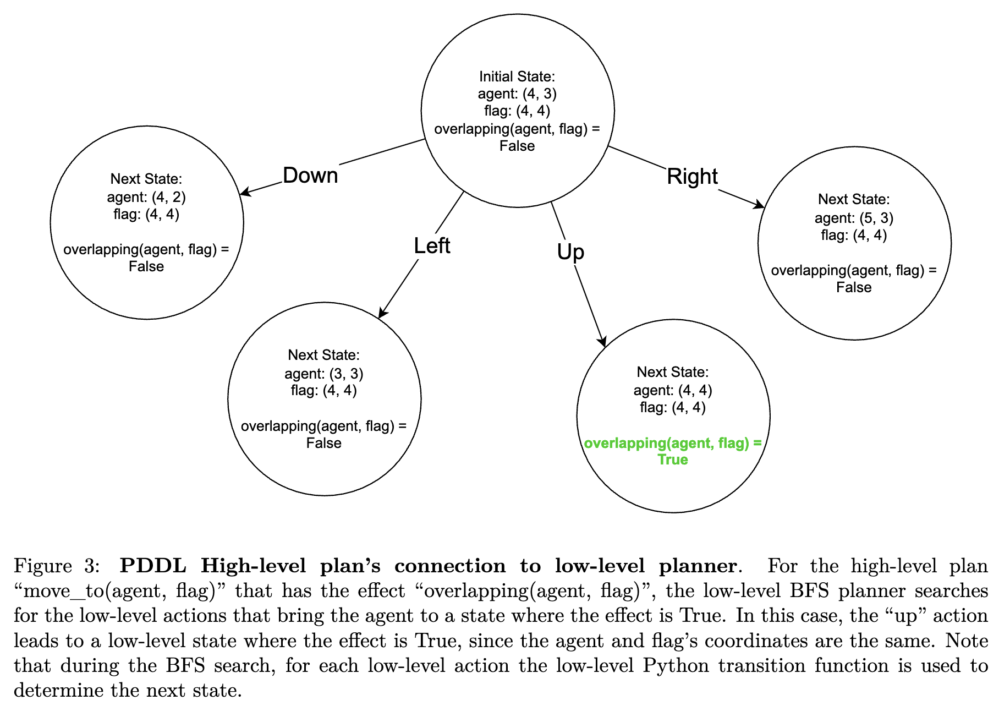
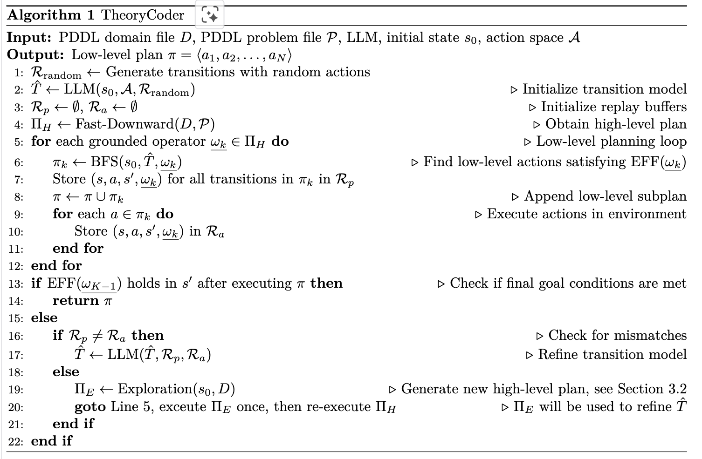
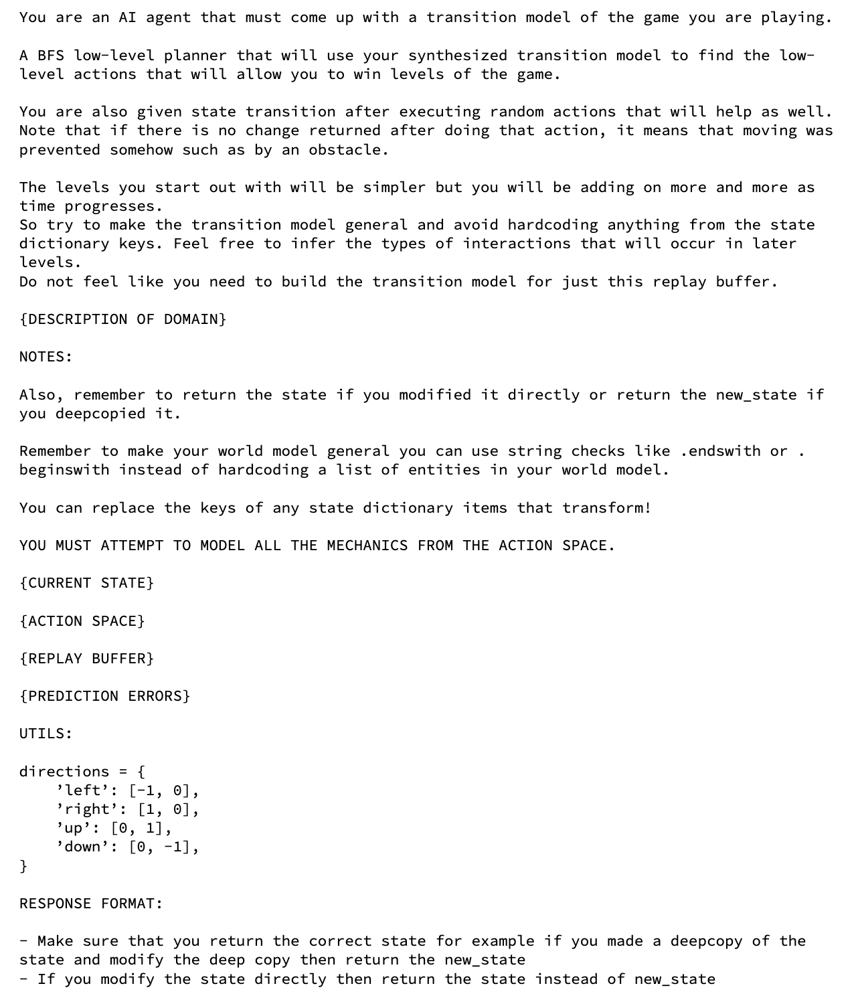
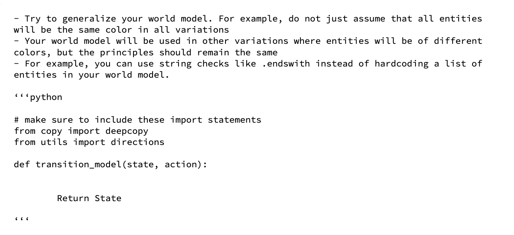
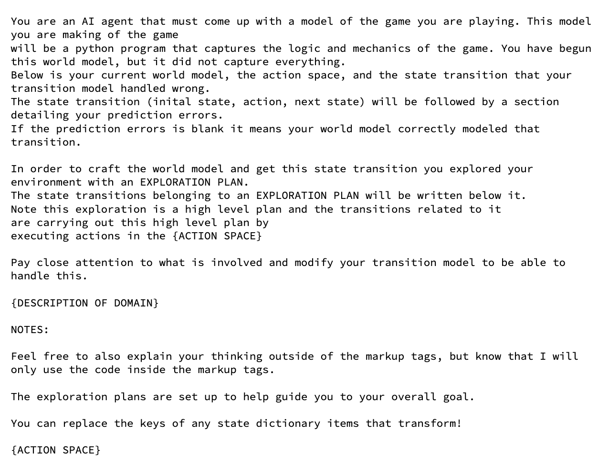
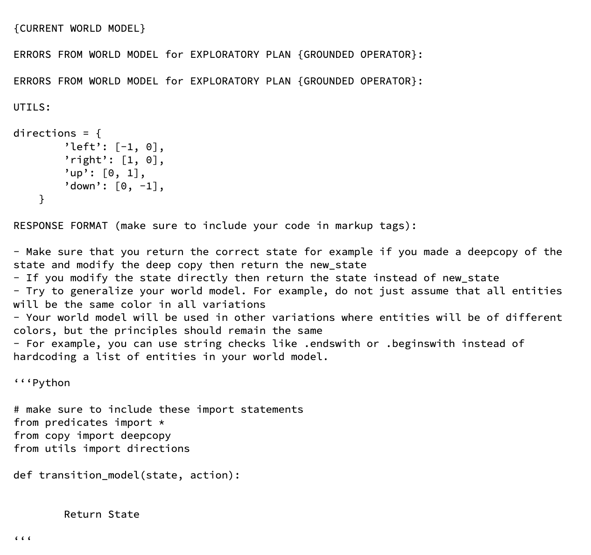
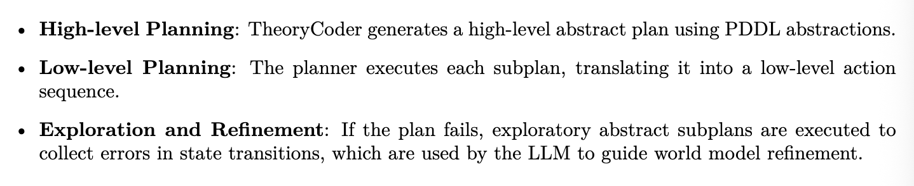

# Synthesizing world models for bileval planning

- **저자**: Zerg Ahmed, Joshua B. Tenenbaum, Christopher J. Bates, Samuel J. Gershman
- **arXiv**: https://arxiv.org/pdf/2503.20124
- **Submission Date**: July 2025
---

- 한줄 요약: LLM이 학습한 low-level Python world model을 주어진 high-level PDDL abstraction과 연결해 **bilevel planning**을 수행

## 1 Introduction

- Video games는 좋은 testbed임
    - RL은 게임에서 좋은 능력을 보였음 (Atari 등)
    - 하지만 인간보다 못함 (특히 variation에서 generalize 못함)

- 최근 LLM 등 foundation model들이 game-playing agents로 쓰임
    - world knowledge로 강한 reasoning 장점
    - 그러나, 예시가 주어지지 않거나 domain이 너무 training set에서 멀면 못함

- 인간이 배우고 계획하는것은 foundation model이랑 end-to-end RL model들이랑 확실히 달라보임
    - 그래서 우리는 인간한테 영감을 받아서, algorithm을 개발할거임
    - 인간은 prior knowledge를 이용해서 새 게임을 함
    - 인간이 structured causal models (=theories)를 배우고, 그걸 planning and exploration에 쓴다는게 *TBRL (theory-based reinforcement learning)*
    - model-based RL에 비해서 TBRL은 motor skills and precise timing에 대해 잘 배우지만, extensive exploration을 필요로하는 domain에서는 약함
    - 인간 인지를 더 강하게 모방하여 이런 gap을 채울 수 있을겨

- Tsividis et al. (2021)은 TBRL을 EMPA 에이전트로 concept proofing을 했음
    - EMPA는 비디오 게임의 rule을 domain-specific language (VGDL)로 배움 
    - Atari-style video games에서 성능 굳

- 하지만 TBRL은 아직도 remains challenging: 현존 TBRL은 두가지 major limitation을 가짐
    1. 그들의 theory languages are restricted to domains that can be represented in VGDL. (반면 인간은 다른 kinds도 잘하쥬?)
    2. TBRL agents가 쓰는 planning algorithm은 not scalable to large state spaces (value-based iteration에 의존하기 때문 -> 차원의 저주 when computing the value for large state-action pairs)

- 우리 논문에서는 TBRL을 새 알고리즘 테크닉으로 extend함 -> 그럼 agent가 more skilled and flexible and tractable 할 수 있음
    1. 장점 1: reusing previously learned, high-level symbolic abstract concepts, adapting them to the particulars of a new domain via a fast-learning mechanism based on **program synthesis**
        - 이러한 high-level abstraction은 planning operators를 포함함 -> 만약 에이전트가 low level details를 빨리 채울 수 있다면  useful concepts를 재활용할 수 있는 것 (매번 새로 배울 필요 없)
    2. 장점 2: much richer set of world model을 얻을 수 있음
        - VGDL이 아니라 Python으로 (아주 expressive!)
        - 이게 되는 이유는 LLM이 있어서

- 미안하다 이거보여주려고 어그로 끌었다: "TheoryCoder"
    1. High-level abstraction: leveraging prior knoweldge in form of general-purpose **high-level abstractions**
    2. Grounds those in particular environments by **synthesizing a low-level transition model** using LLM queries -> 이 transition model은 flexible한 동시에 tractable함 
    3. 마지막으로 TheoryCoder가 이렇게 나온 learned model 및 high-level abstraction을 bileval planning 알고리즘을 통해 task를 품
        - 이 떄 bilevel planner는 모호한 PDDL을 harness to contstrain search in the low-lvel state space -> 인간의 체계적인 planning 사고 과정과 유사

## 2 Related Work

### 2.1 Theory-based RL

#### 2.1.1 Human Learning

- 인간은 prior knowlege를 잘 leverage
- 이것이 가능한 이유: strong inductive bias (귀납적 편향: 새로운 데이터를 학습할 때 미리 가지고 있는 가정이나 선호)를 갖고 있음 -> constrain the vast hypothesis space
- 인간의 학습은 form of domain-specific theory learning, subject to abstract structural constraints and prior knowledge.

#### 2.1.2 Human learning principles missing in Deep RL

- 근데 위에서 언급했던 human learning priniple은 여태까지의 Deep RL에서 배재되어왔음
- 즉, weak inductive bias를 갖고 있기 때문에 training을 많이 하면 성능이 좋지만 generalization과 sample efficiency가 없을 때는 힘들 못씀
- Classical model-based RL systems: cannot scale 
- Deep neural networks to approximate dynamics: cannot explicitly represent causal laws governing interactions between objects -> generalization 똥

#### 2.1.3 Limitations of current Theory-Based RL systems

- 구조화된 representation을 배우기 때문에 TBRL도 한계가 있었음
    1. 이전에는 **hand-designing the agent's hypothesis space** 각 도메인별로 인간이 만듦 -> 이 논문에서는 그 문제를 없애진 않지만 address는 함
    2. 이전 연구에서는 approximate Bayesian inference 수행, which can be slow or interactable for large hypothesis space -> 이 논문에서는 neuro-symbolic approach로 approximate inference 분량을 줄임
    3. theory를 배워도 efficient planning은 쉽지 않음 (run-time issue) -> 이 논문에서는 run-time computation을 bileval planning with PDDL operators를 통해 빠르게 함

#### 2.2 Model-based reasoning

#### 2.2.1 Neural Models

- Model-based reasoning -> various contexts, including RL and robotics
- 예시) neural world model that compress 고차원 픽셀 -> compact latent vector in the latent space -> simulation and prediction

#### 2.2.2 Symbolic Models

- Symbolic world models: program synthesis approaches which seek to find programs that faithfully model key aspects of an environment's dynamics
- 가장 큰 장점: Structural and Compositional -> 바꾸거나 조정하는게 가능함
- 한계: prohibitively expensive to enumerate all possible programs, thus learners need ways to cut down search times. 모든 program synthesis techniques에서 발생하는 문제.
    - DSL 등에서는 possibilities를 narrow 

#### 2.2.3 Synthesizing models using LLMs

- LLM을 도입함으로서 앞서 말한 문제를 address
- LLM들은 코드를 enumarate하게 생성하지 않음. 
- LLM들은 search process를 직접적으로 수행하지 않고서 search solution을 approximate 할 수 있음
- 따라서 이 논문에서도 LLM을 online program synthesis에 이용함. (specifically, synthesis of the low-level transition model)
- 다만 차별점: two seperate levels of abstraction -> planning efficiency and learning converngece benefic

### 2.3 Bilevel Planning (이중 수준 계획)

- Robotics (task-and-motion-planning)에서 많이 쓰임
- States and actions을 위해 abstract representations 사용
    - abstract states -> referred to as predicates
    - abstract actions -> referred to as operators
- Planning problem은 보통 PDDL로 표현됨

- 근데 Abstraction들은 보통 학습보다는 hand-designed됨
    - 이 논문의 차별점: operators를 low-level transition model의 learning을 가이드 하는데 씀. -> more granular domain mechanism capture

### 2.4 LLMs for planning and low-level policies

- LLM, VLLM prompting
    - input: text-based state representation of the domain
    - output: plan
- 문제: spatial reasoning issues and hallucinations

## 3 Theory Coder

### 3.1 Overview

- 아래 figure: iterative cycle of hierarchical planning, acting, and model updating architecture

- 아래 figure: PDDL planner가 어떻게 high-level plans를 만드는지 -> 이후 low-lvel breadth-first search (BFS) planner에 의해 executable actions으로 바뀜 

- 아래 figure: BFS planner는 world model에서 transitions를 simulating함으로서 적절한 action sequence를 판별함

- 실패하는 경우
    - high-level plan의 실패 -> world model undergoes refinement (correcting explicit errors or identifying discrepancies through exploratory goals)
    - Simulation이 terminate하지 않는 경우 -> exploratory goal is initiated to uncover missing dynamics in the model

### 3.2 Preliminaries

- Classifical planning problem
    - transition function T: S X A
    - goal of agent: find a plan (sequence of actions) ${\pi}$ that minimizes the sum of cost of taking action in state n
        - 이 논문에서 cost c(s,a)는 constant로 취급
    - optimal plan: shortest sequence
- The agent has acess to an estimate ${\hat{T}=f(D)}$
    - D: observation data
    - f: estimation algorithm

### 3.3 Theory language

- transition funciton = low-level dynamics of the environment
    - agent는 abstract actions (operators)와 states (predicates)를 나타냄
        - actions: mapping from an action sequence to a target state
        - states: Boolean predicate that encodes features of the state that are important for planning

- 추후 이 low-level transition fuction은 high-level abstraction이랑 combine됨

- 쓰이는 언어는 두 가지
    1. PDDL: represents the domain using high-level abstractions and handles the high-level planning for TheoryCoder
    2. Python: represents the domain's low-level state space and handles the low-level planning in the raw state space

- 여기서 잠깐! PDDL이란?
    - Planning Domain Definition Language
    - Agent가 목표를 달성하기 위해 "어떤 행동"을 "어떤 순서로" 수행해야하는지 계획할 수 있도록, **환경**과 **행동**을 정의하는 언어 
    - 주로 AI Planing에서 사용됨
    - 다음 세 가지를 정의함
        1. Initinal State (초기 상태)
        2. Actions (행동)
        3. Goal State (목표 상태)
    - 중요한 것은 각 행동에 Precondition (전제조건)과 Effect(효과)가 있다는 것
    - 이 논문에서의 예시:
        - PDDL: 열쇠를 획득하고 문을 여셈
        - Python: 오른쪽 3칸 이동 -> 위쪽 2칸 이동 -> 열쇠 획득 -> 아래로 3칸 이동 -> 문 열기

#### 3.3.1 High-level planning and abstractions

- 먼저 Fast-Downward (Helmart, 2006)라는 PDDL planner로 high-level output을 만들어냄 (problem file and domain files are hard coded)
- 그리고 나서 low-level에서 파이썬 최적화 하는거 ㅇㅇ

#### 3.3.2 Low-level Python transition function and planning

- Python versions of the predicates -> bridge between the high-level PDDL abstractions and low-level Python components
    - bridged by function called "checker": that maps abstract states to low-level states
    - checker function은 low-level states가 given grounded operator를 다 만족시켰는지 판정함
- Figure 3이 그 예시

### 3.4 Learning

- Planning 전: TheoryCoder는 최대 10회까지의 랜덤 액션을 취함 -> to gather a replay buffer of experience
- LLM의 Planning: 
    1. 먼저 initial state, low-level executable action space, replay buffer of random actions, description of the domain in narutral languages를 포함하는 쿼리로 프롬프팅됨 
    2. 만약 결과가 별로면 revision 수행
    3. 그래도 안되면 exploratory plans를 나열 

- 아래 사진: (위) Initial prompt, (아래) Revision prompt 

### 3.5 Summary

TheoryCoder는 TBRL (Theory-Based RL) framework의 사례로서 LLM을 이용하여 Python-based world model을 구현한다. 
반면 이전 연구 (EMPA 등)에서는 theory 표현을 bayesian inference 기반으로 VGDL (게임 특수 목적 언어) 표현으로 나타내어 한계가 있었다. 
이 논문의 연구에서는 iterative iteraction loop를 통해 월드 모델을 개선해 나간다. 

