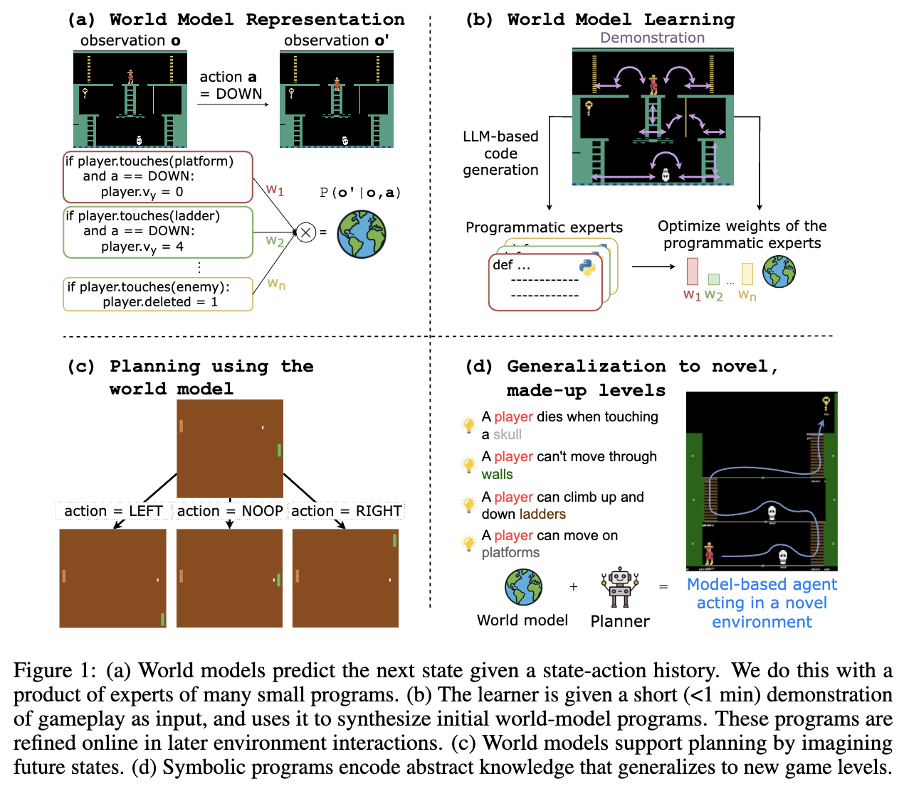

# PoE-World: Compositional World Modeling with Products of Programmatic Experts

- **저자**: Wasu Top Piriyakulkij, Yichao Liang, Hao Tang, Adrian Weller, Marta Kryven, Kevin Ellis
- **arXiv**: https://arxiv.org/abs/2505.10819
- **Submission Date**: May 2025
---

- 한줄 요약: 

## 1 Introduction

- Main contribution
    1. The PoE-World representation and learning algorithm for symbolic world models
    2. An empirical study of PoE-World on two representative Atari games, Pong, Montezuma's Revenge
        - demonstrated its **superior learning efficiency** compared to **deep RL**
        - improved **scalability** compared to **SOTA symbolic model-based RL**
    3. Demonstration of how to use PoE-World's world models or planning-based decision making, and as a simulated pretraining environment for deep RL.

## 2 Background: World Model Learning

- 문제 정의
    - Sequential decision-making problem = ${(O, A, P, R)}$ -> 이 문제는 POMDP로 정의됨
        - O: observation space
        - A: action space
        - P: environment dynamics
        - R: reward function
    - 이 논문에서 집중하는 것은 world model인 ${P^ = p_{model}(o_{t+1})}$ -> "진짜 world model인 P를 approximate하는 것"
    - 이 논문에서 world modeling problem은 **optimization problem**으로 정의함. -> empirical risk minimization
        - 이때 l은 loss function (= negative log likelihood)

- 이전 연구들
    - 이전 model-based reinforcement learing 연구에서는 DNN (CNN, transformers, diffusion 등)을 이용하여 ${p_{model}}$ 을 parametric model로 정의함 (${p_{\theta}}$)
        - 이후 ${\theta}$ 는 gradient descent로 최적화됨
        - 이러한 방법의 단점: poor sample efficiency and generalization
    - 또 다른 연구들에서는 LLMㅇㄹ 이용하여 code world model을 합성
        - 이건 programatic ${p_{\theta}}$ 을 찾는 것으로 봐도됨
        - 이러한 LLM-based code generation algorithm의 장점: more sample efficient and extrapolate (추론/추정하다) more systematically
        - 하지만 이러한 방법론들은 현재의 simple text-based and gridworld games들을에 국한되어 있음.

## 3 Modeling the World as a Product of Programmatic Experts (PoE-World)

- 위에서 언급한 한계를 극복하기 위해 **"Products of programmatic Experts" (PoE-World)** 제안

- Figure 1은 'representation'과 'learning algorithm'을 보여줌

### 3.1 World Model Representation: Prodect of Programmatic Experts (PoE-World)

- A factored state representation yield tractable inference

- Benefits of the full-history formulation over POMDP formulation

- Hard constraints

- Multi-timestep predictions

### 3.2 World Model Learning: Program Synthesis and Weight Optimization

- Generating program experts.

- Gradient-based Weights Optimization

### 3.3 World MOdel Usage: RL in Simulation and Planning with World Model

## 4 Experimental Results

- Baselines
    - PPO
    - LLM as Agent (ReAct)
    - WorldCoder

- Agent Results

- Instead of planning, can we use PoE-World to learn a *policy*?

- Next Observation Prediction Results

- The role of hard constraints

- Qualitative difference between WorldCoder's and PoE-World's world models

## 5 Related Work

- World models as programs
    1. **WorldCoder, CodeWorldModels**: use *LLMs* to write a *Python* transition fuction
        - prior works learn a single monolithic program which severaly limites scalability
        - this research's world models have an order of magnitude more code to model complex environments, as well as handle partial observability and non-determinism.
    2. **Synthesizing high-level abstract world models as programs** to support robotic planning by *intergrating visual perception* with symbolic reasoning.
        - these could synergize with this research's work
    3. Earlier works learn world models in **restricted (non-Turing complete) domain specific programming languages**
    4. More earlier, **Schema Networks** learn a conceptually related *factor-graph world model* 
    5. **AIXI**: theoretical model of reinforcement learning which considers *all possible Turing machines*
        - mathematically related to all these works
        - AIXI also works with way of modeling partial observability
    6. Other studies generate programs for world models primarily from natural language instructions, rather than from example interactions with the environment

- Hierarchical Planning

- Alignment with human cognition

## 6 Discussion and Limitation

- Compositionality

- Limitations