# PoE-World: Compositional World Modeling with Products of Programmatic Experts

- **저자**: Wasu Top Piriyakulkij, Yichao Liang, Hao Tang, Adrian Weller, Marta Kryven, Kevin Ellis
- **arXiv**: https://arxiv.org/abs/2505.10819
- **Submission Date**: May 2025
---

- 한줄 요약: 

## 1 Introduction

- Main contribution
    1. The PoE-World representation and learning algorithm for symbolic world models
    2. An empirical study of PoE-World on two representative Atari games, Pong, Montezuma's Revenge
        - demonstrated its **superior learning efficiency** compared to **deep RL**
        - improved **scalability** compared to **SOTA symbolic model-based RL**
    3. Demonstration of how to use PoE-World's world models or planning-based decision making, and as a simulated pretraining environment for deep RL.

## 2 Background: World Model Learning

- 문제 정의
    - Sequential decision-making problem = ${(O, A, P, R)}$ -> 이 문제는 POMDP로 정의됨
        - O: observation space
        - A: action space
        - P: environment dynamics
        - R: reward function
    - 이 논문에서 집중하는 것은 world model인 ${P^ = p_{model}(o_{t+1})}$ -> "진짜 world model인 P를 approximate하는 것"
    - 이 논문에서 world modeling problem은 **optimization problem**으로 정의함. -> empirical risk minimization
        - 이때 l은 loss function (= negative log likelihood)

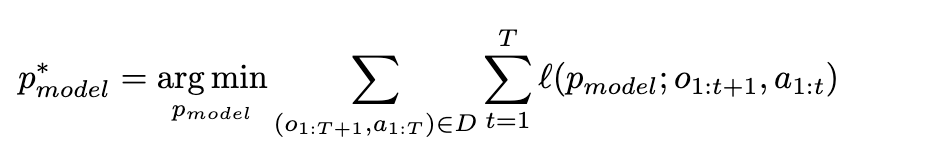

- 이전 연구들
    - 이전 model-based reinforcement learing 연구에서는 DNN (CNN, transformers, diffusion 등)을 이용하여 ${p_{model}}$ 을 parametric model로 정의함 (${p_{\theta}}$)
        - 이후 ${\theta}$ 는 gradient descent로 최적화됨
        - 이러한 방법의 단점: poor sample efficiency and generalization
    - 또 다른 연구들에서는 LLMㅇㄹ 이용하여 code world model을 합성
        - 이건 programatic ${p_{\theta}}$ 을 찾는 것으로 봐도됨
        - 이러한 LLM-based code generation algorithm의 장점: more sample efficient and extrapolate (추론/추정하다) more systematically
        - 하지만 이러한 방법론들은 현재의 simple text-based and gridworld games들을에 국한되어 있음.

## 3 Modeling the World as a Product of Programmatic Experts (PoE-World)

- 위에서 언급한 한계를 극복하기 위해 **"Products of programmatic Experts" (PoE-World)** 제안

- Figure 1은 'representation'과 'learning algorithm'을 보여줌

### 3.1 World Model Representation: Prodect of Programmatic Experts (PoE-World)

- 위 PoE-World의 정의는 다음과 같은 수식으로 표현됨:
    - 이 때 ${p_i^{expert}}$ 는 programs와 ${{\theta}_i}$ 의 결합이며, 이때 세타는 scalar weights로 가중합 되어있음 

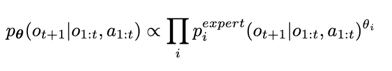

- 이러한 representation은 **modularity**와 **compositionality**를 가능하게 함: many small programs의 composing. 각 작은 programs는 world의 각 particular space를 표현함 (Figure 2에 예시)

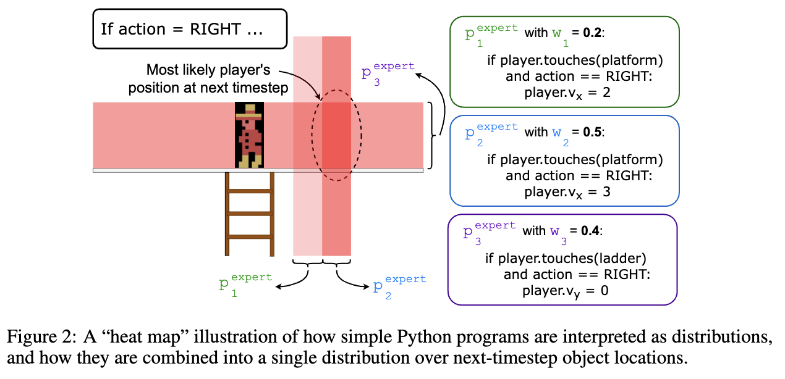

- A factored state representation yield tractable inference
    - object-centric state를 가정함. 이 때 각 object는 bounding box와 velocities를 가짐 (each stored as a separate slot, attribute, or feature)
    - 이 때 각 feature는 **conditionaly independent**로 가정
    - 아래 수식에서 f는 다음 observation(${o_{t+1}}$)의 different object features의 지표이며, o^f는 f를 가지는 o의 지표이다.

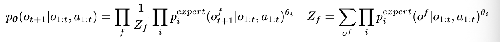

- Benefits of the full-history formulation over POMDP formulation
    - full-history environment formulation = POMDP
    - 지난 역사를 다 Markov latent state로 압축시킨다
    - 이거 쓰는 이유: to make world modular -> Independent learning/mechanism

- Hard constraints
    - Atari와 real world는 learnable program으로 시뮬레이션하기 너무 complex함
    - 따라서, 이 논문에서는 over-approximate the set of possible features하여 간단하게 표현
    - 예를 들어 게임에서 캐릭터가 떨어지는 것을 모델링 할 때 물리적으로 이론상 완벽하게 하지 않고, 그냥 generic downward trajectory 사용 
    - 따라서 model's outputs를 sharpen하기 위하여 collection of hard contraints {c_j}를 익힘 이때 C_j는 binary (0 또는 1)

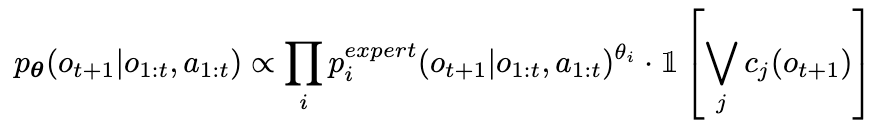

- Multi-timestep predictions
    - next-timestep expert를 multi-timestep expert로 가능하게 하는 것: products of next-timestep experts를 각자 다른 time-step에서 independent하다고 가정 하는 것 

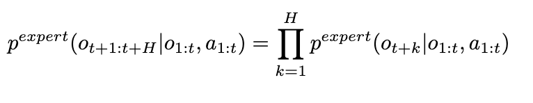

### 3.2 World Model Learning: Program Synthesis and Weight Optimization

- Learning process:

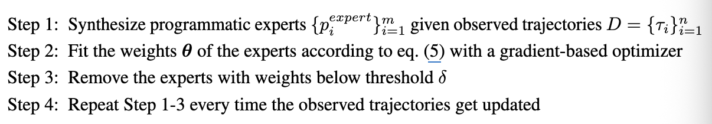

- Generating program experts.
    - LLM한테 Python 시킴
    - small batch of transitions을 LLM prompt에 넣고 programmatic experts 생성
    - small Python program을 어떻게 interpret하는지는 위의 figure 2에 나와있음
    - 관측은 각 object의 **x/y velocity**와 **visibility**로 넣어짐
    - 이후 noise를 더함으로서 zero probabilities를 방지 -> if-condition이 안 채워질 경우 experts는 *uniform distribution*임

- Gradient-based Weights Optimization.
    - 그렇게 해서 LLM이 만든 expert (${p_i}$)가 준비되면 MLE 시전 가능 (세타 얻으려고)
    - optimizer: any gradient-based thing
    - 사전 정의한 threshold에 못미치면 그 expert는 삭제

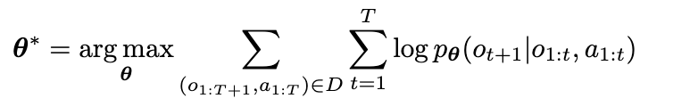

### 3.3 World MOdel Usage: RL in Simulation and Planning with World Model

- World model을 어따 갖다 쓰는가?
    1. RL할 때 갖다 쓴다: RL policy learning을 more sample efficient하게 만들어줌
    2. Agent의 lookahead planning에 쓴다: reward function R이 있을 때 horizon H까지의 timestep planning 수행 
        - 이 때 논문에서는 hierarchical planner TAMP 사용. (figure 3 참고)
        - 먼저 highh-level abstract state space에서 plan하고 그걸 actual Atari button으로 lower
        - 즉, resulting agent는 **PoE-World + Planner** 

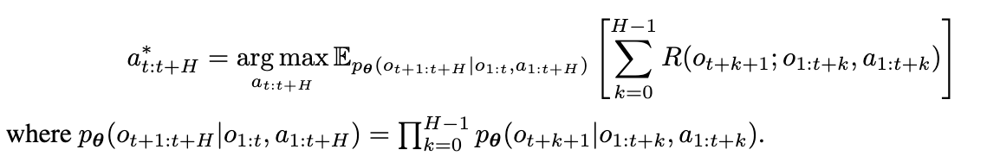 

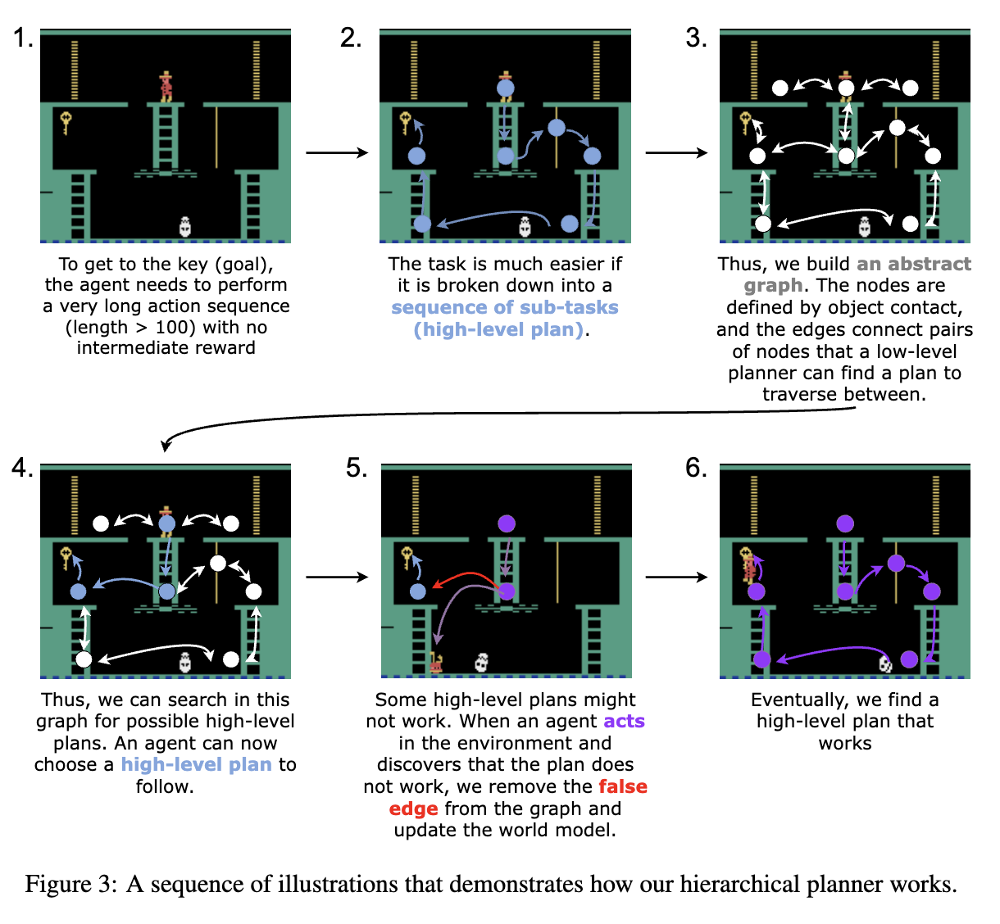

## 4 Experimental Results

- Domains and Evaluation
    - 대상 agent: PoE-World + Planner
    - Domain: Atatri's Pong, Montezuma's Revenge 

- Baselines
    - PPO
    - LLM as Agent (ReAct)
    - WorldCoder

- Agent Results

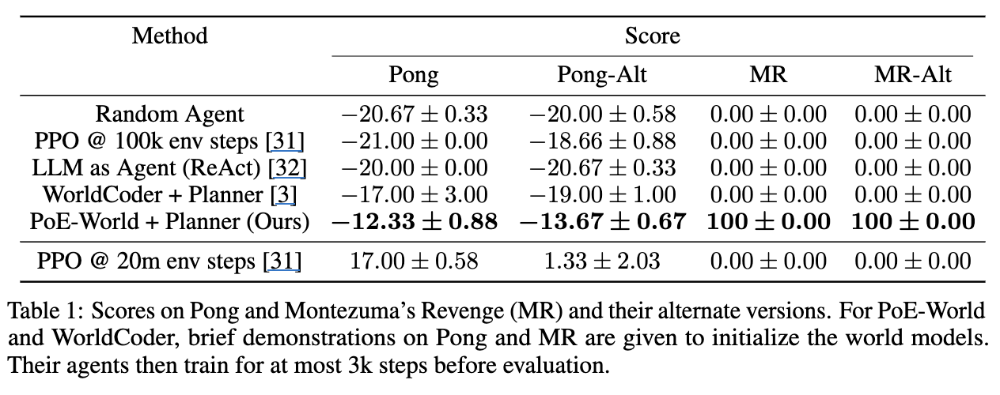

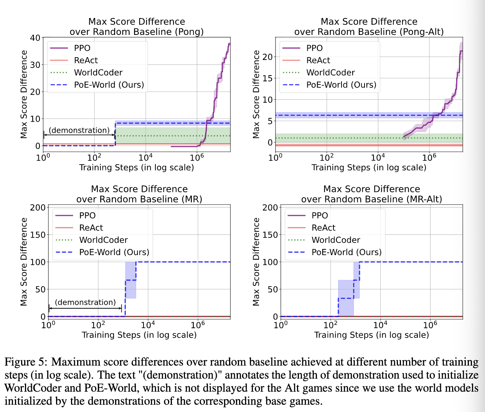

- Instead of planning, can we use PoE-World to learn a *policy*? -> ㅇㅇ 도움됨 (figure 6)

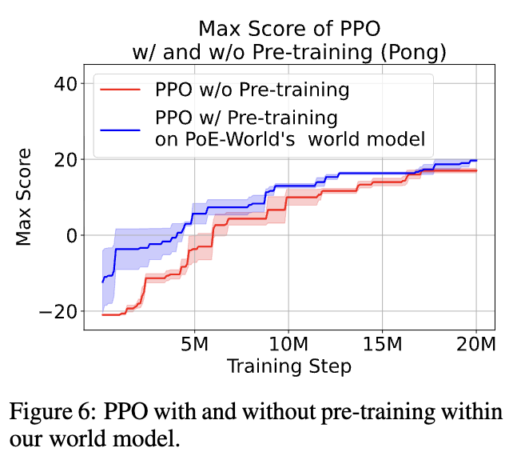

- Next Observation Prediction Results (table 2,3)

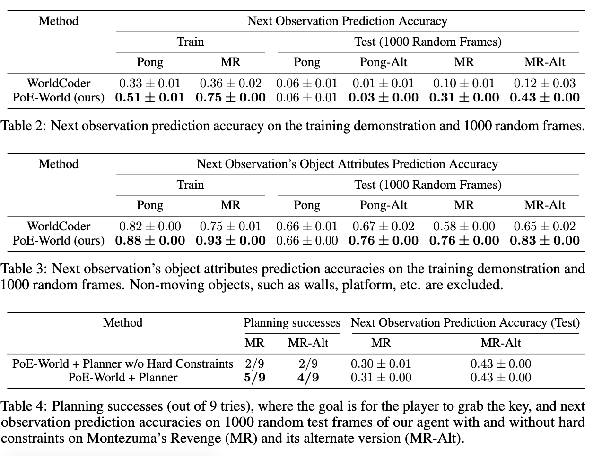

- The role of hard constraints (table 4)
    - hard constraints는 "physically impossible"한 것을 막아줌
    - 지우면 agent performance 낮아짐

- Qualitative difference between WorldCoder's and PoE-World's world models
    - PoE-World는 4000+ 코드로 구성되어 있으며 (Montezuma's Revenge 기준) 이는 직전 연구인 WorldCoder 보다 100줄 정도 적음 (음?)

## 5 Related Work

- World models as programs
    1. **WorldCoder, CodeWorldModels**: use *LLMs* to write a *Python* transition fuction
        - prior works learn a single monolithic program which severaly limites scalability
        - this research's world models have an order of magnitude more code to model complex environments, as well as handle partial observability and non-determinism.
    2. **Synthesizing high-level abstract world models as programs** to support robotic planning by *intergrating visual perception* with symbolic reasoning.
        - these could synergize with this research's work
    3. Earlier works learn world models in **restricted (non-Turing complete) domain specific programming languages**
    4. More earlier, **Schema Networks** learn a conceptually related *factor-graph world model* 
    5. **AIXI**: theoretical model of reinforcement learning which considers *all possible Turing machines*
        - mathematically related to all these works
        - AIXI also works with way of modeling partial observability
    6. Other studies generate programs for world models primarily from natural language instructions, rather than from example interactions with the environment

- Hierarchical Planning

- Alignment with human cognition

## 6 Discussion and Limitation

- Compositionality:
    - code compositionality가 제일 큰 contribution

- Limitations: 
    - pixel로부터 배우지 않고, symbolic inputs로부터 배움
    - RL은 exploration, decision-making, reward function learning을 involve하지만 이 논문에서는 걔네에 대해 다루지 않음