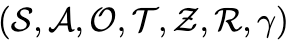
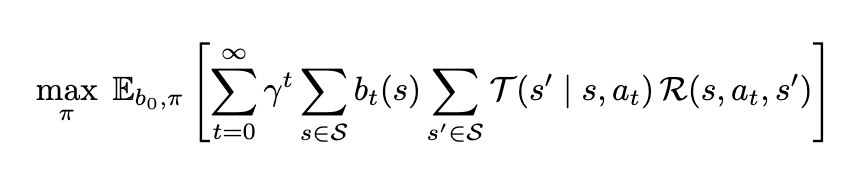
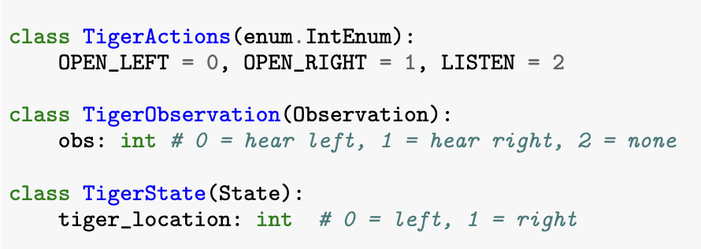
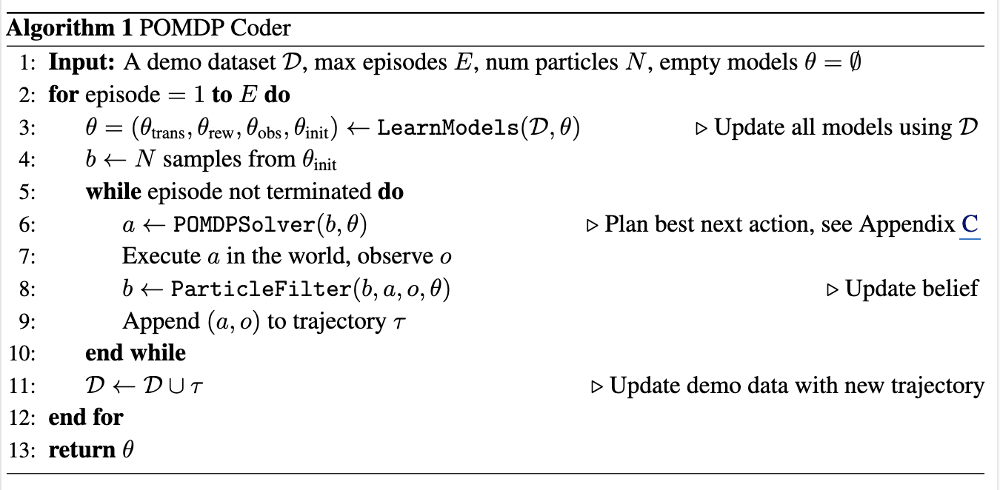
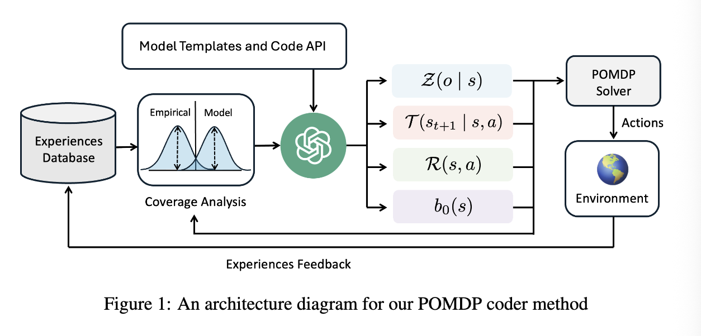
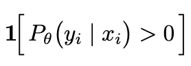
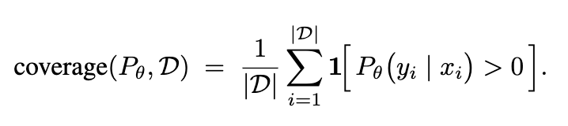
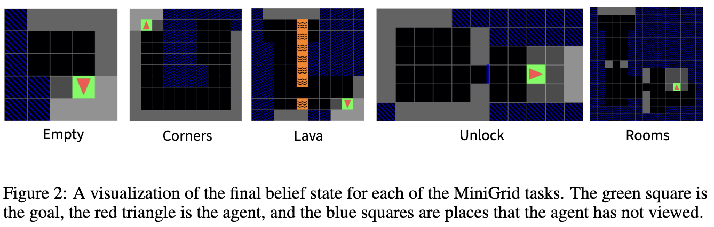

# POMDP Coder: LLM-Guided Probabilisstic Program Induction for POMDP Model Estimation

- **저자**: Aidan Curtis, Hao Tang, Thiago Veloso, Kevin Ellis, Joshua Tenenbaum, Tomas Lozano-Perez, Leslie Pack Kaelbling
- **arXiv**: https://arxiv.org/pdf/2505.02216
- **Submission Date**: May 2025
---

- 한줄 요약: 명시적인 **belief state**를 두는 POMDP **처음** 사용

## 1. Introduction

- POMDP provides a principled framework for modeling and solving problems, which is decision making under uncertainty, by explicitly representing uncertainty in **state perception, transitions, and rewards**. 

- Despite many prior works, practical application of POMDPs is bottelnecked by difficulties in **specifying accurate models of environments**

- In this paper, a critical challenge of **learning interpretable, low-complexity POMDP models directly from data** is addressed. 
    - POMDP components are represented as **probabilistic graphical models encoded by short probabilistic programs** using LLMs
    - Candidate probebilistic programs are evaluated against empirical observations and iteratively refined through LLM generated feedback.
    - 실험 결과, 논문에서 제시한 방법론이 significantly enhances sample efficiency compared to traditional tabular model or behavior learning methods and achieves greater accuracy than directly querying an LLM.
     

## 2. Related Work

- 여기서 집중하는 것: 
    1. methods that emphasize **extreme data efficiency** through the use of explicit models and representations
    2. methods that **use LLMs** to synthesize and refine these models

### 2.1 POMDP Model Learning

- challenge of learning POMDP models from experience: estimating the parameters of certain HMM is computationally intractable in general.

- Bayesian methods (such as Bayes-Adaptive POMDPs)
    - 방법: incorporate model uncertainty directly into decision-making by unifying *model learning, information gathering, and exploitation*
    - 단점: POMDP의 overall complexity를 증가시킴

- Optimism-based exploration algorithm
    - 장점: yields theoretical guarantees for efficient learning in specific POMDP subclasses
    - 단점: challenging to apply directly to real-world, complex domains

- Apprenticeship learning (도제 학습): 전문가의 시연을 보고 "어떤 환경이라면 저 순간에 저 행동을 하는 게 합리적일까?"를 거꾸로 추론하는 방법
    - estimate POMDP parameters by leveraging expert demonstrations
    - assumes that expert behavior encapsulates informative state-transition dynamics
    - 장점: helps reducing the burden of exploration
    - 단점: sensitive to the quality of the expert demonstrations

### 2.2 Probabilistic Program Induction

- 정의: concise, symbolic representation을 이용하여 복잡한 시스템을 모델링 
- 장점: can lead to markedely improved data efficiency and enable few-shot learning (in stark contrast to more data-intensive conventional methods)
- 단점: the vast search space inherent to probabilistic programs can be a major computational bottleneck -> 최근 연구에는 여기에 LLM을 결합함으로서 human priors를 infuse

### 2.3 LLM Model Learning for Decision-Making

- Prior Works
    1. fully observable settings: transition dynamics and reward structures are represented using frameworks such as PDDL or code-based models
    2. other approaches: utitilized code-based representations as constraints or as part of optimization frameworks

- 이 연구에서 POMDP setting에서 LLM을 이용한 world-moeling for decision making이 처음임 

## 3. Background

### 3.1 POMDPs

- POMDP is defined by the tuple  
    - S,A,O: state, action, observation space
    - 이 연구에서는 이러한 space들이 discrete하다고 가정하지만, 보통 POMDP는 continuous space임
    - ${T(s_{t+1} | s_t, a_t)}$ : districution over next states expeted when taking action in state
    - ${Z(o_t | s_{t+1} | a_t)}$ : observation model
        - represents the distribution over observations expected when executing action a_t resulting in a subsequent state s_t+1
    - ${R(s_t, a_t. s_{t+1})}$ : reward function
    - ${\gamma}$ : 0 또는 1. Discount factor
        - weighs the value of current rewards over future ones

- POMDP에서는 실제 true state s_t을 모르므로, **belief ${b_{t}(s)}$ 또는 probability distribution over possible states**를 maintain 해야됨
    - 이때 새 observation에 따른 새 action이 취해진 후에는 항상 probability distribution 또는 belief를 업데이트 해야됨 
    - 이때 업데이트 할 떄 쓰는게 *particle filtering*: 실제 상태에 대한 여러 추측을 갖고 있다가, 새로 관측한 단서에 맞춰 각 추측의 **비중**을 바꾸는 방법. Particle 하나는 가능한 상태를 하나 뽑은 샘플이며, 이 입자들을 모아서 논문이 말하는 belief를 계산

- The objective of POMDP: is to find a policy ${\pi}$ that maximizes the expected discounted reward (익숙하쥬,,)

### 3.2 Probabilistic Programs

- 이 연구에서 POMDP의 각 component들은 short probabilistic program으로 encoding됨
    - 이때 이 component에는 initial state model, transition dynamics, observation function, reward structure 포함
- 이 때 사용하는 프로그래밍 프레임워크가 *Pyro*
    - stochastic behavior를 띄는 generative model을 작성할 수 있게 해줌

### 3.3 POMDP Solvers

- Offline solvers (traditional): high-dimensional or continuous environments으로 확장하려고 할 때 scalability challenge를 맞이하게 됨.

- Online solvers: focus on finding a solution from a specific initial belief and replan after every step as new observations become available.
    - 예시 1: POMCP (Partially Observable Monte Carlo Planning) 
    - 예시 2: POUCT (Partially Observable  Upper Confidence Trees)
    - 이 연구에서는 determinized belief space planning을 선택 
        - 이유: computational efficiency
        - belief space planners는 stochastic nature of the problem을 deterministic하게 바꿈

## 4. POMDP Coder

- Problem은 두 가지 메이저 components로 구성
    1. **learning the probabilistic models** that define the POMDP 
        - initial state, transition, observation, reward fuction을 위한 candidate probabilistic program을 생성/수정/검증하는데 LLM 사용
    2. using the learned models for **online planning**.
        - 위에서 배운 model을 현재의 belief와 함께 online POMDP solver로 사용

- Assume: 
    - agent에게 인간이 생성해낸 10개의 **demonstration ${D}$** 를 제공하는 것을 가정 
        - 각 D는 (s_t, a_t, o_t, s_{t+1}) transitions를 지니고 있음
    - **post-hoc full observability** 가정
        - 각 episode가 끝난 후 그 판의 매 순간 실제 상태가 어땠는지 확인할 수 있다는 가정

- POMDP coder에게는 structure of state, action, observation space에 대한 code-based API를 제공받음.
    - 아래는 호랭이 문 상황에서의 예시

- 아래의 <알고리즘 1>으로 POMDP 코더가 작동함.
    1. the coder proposes an initial set of models that comprise POMDP problem
    2. initial set of models가 정해지고 나면, 이 모델들이 POMDP solver에게로 전달됨
        - 이 때 initial belief도 주어지고, 환경에서 취할 optimal first action을 탐색 시작
    3. 행동을 취하고 나서 observation을 받으면, belief를 update (using particle filtering)

- 이러한 알고리즘 과정은 episode terminate 또는 time out까지 반복됨
- 에피소드 끝에는 해당 trajectory가 dataset에 추가되고, learning process repairs 

### 4.1 Learning Models

- POMDP의 네 가지 core components를 학습시키는 것이 목표임
    1. initial state distribution ${P(s_0)}$
    2. transition model ${P(s_{t+1} | a_t)}$
    3. observation model ${P(o_{t+1} | s_{t+1}, a_t)}$
    4. reward model ${R(s_t, a_t, s_{t+1})}$

- learning procedure의 목적 함수: **dataset coverage metric**을 최대화
    - coverage란?: 실제 데이터에 기록된 결과 중에서, LLM이 만든 world model이 '실제로 발생할 수 있다'고 인정하는건 몇 %인가 (조금이라도 확률을 주면 1, 확률을 0으로 두면 0) 
    - 이 metric이 선택된 이유: 코드를 어떻게 고칠지 LLM에게 알려주기 쉽기 때문에
        - 실제로 호랑이가 오른쪽에 있었고, 오른쪽 소리 2번 + 왼쪽 1번 소리로 기록이 된 상황에서
        - LLM의 첫번째 코드는 "항상 호랑이가 있는 쪽에서 소리가 난다" 
        - 근데 위 코드는 첫 두 기록은 설명이 되지만 왼쪽 소리 기록은 설명할 수 없음 -> coverage 2/3
        - 연구진은 LLM에게 실제 기록을 보여줌 -> LLM이 코드를 고침 "대부분 호랑이 쪽에서 들리지만, 가끔은 호랑이가 없는 쪽에서도 들린다"
        - 고친 코드는 현상을 설명할 수 있음 -> coverage 3/3

- 논문의 learning strategy는 두 가지 operation 사용
    1. LLM program **proposal** given a model function template and a set of examples from the database
    2. LLM program **repair** given a previous model and set of examples that the previous model failed to cover.

## 5. Experiments

### 5.1 Simulated Experiments

1. classical POMDP problems - tiger problem, rock sample problem
2. MiniGrid tasks - 5가지 환경에서 실험

### 5.2 Baselines

- **oracle**: hardcoded to excatly match the true dynamics of the environment. (upper bound 역할)
- **direct LLM**: POMDP coder랑 같은 정보를 제공받는 다이렉트 프롬프트 LLM
- **behavior cloning**: a policy is constructed by mapping states to actions using a dictionary learned from the demonstration dataset.
- **offline only ablation POMPD Coder**: only human demonstrations
- **online only ablation POMPD Coder**: only from own experiences 

### 5.3 Simulation Results

### 5.4 Real Robot Experiments

## 6. Discussion

## 7. Limitation