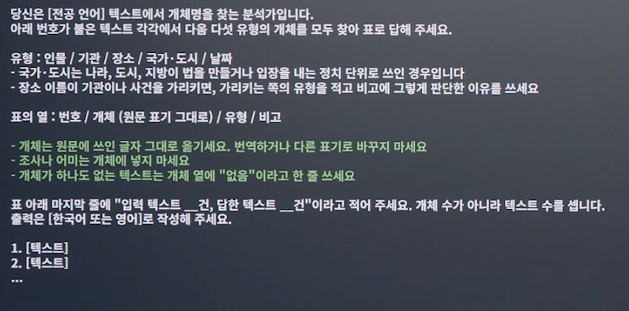

# Week 10

## die Metonymie

- Karlsruhe 
    - 독일 연방헌법재판소
    - [기사](https://www.apotheken-umschau.de/gesundheitspolitik/triage-urteil-bundesverfassungsgericht-kippt-bundesweite-regelung-1432811.html) 

- Brüssel 
    - EU 기관 
    - [기사](derstandard.at/story/3000000318813/bruessel-verklagt-ungarn-wegen-sondersteuer-fuer-supermarktketten)

## 개체명 인식 (독일어)

1. O. 명사 첫 문자가 모두 대문자라서, 대문자로 시작한다고 해도 개체명일 것이라는 판단이 불가능함
2. O.
3. O. 명사 격변화 존재
4. X

## HF 실습

> 모델 전공언어, 멀티링구얼로 찾고, 아래 6가지 물음에 답하기

1. 무엇으로 배웠는가
2. 어느 언어로 배웠는가
3. 몇 카테고리로 나누는가
4. 얼마나 맞는가 (평가 지표 유무)
5. 기반 모델
6. 무엇을 찾는 모델인가

> 기록 양식: 검색일, 검색 경로, 결과 수, 확인한 모델, 위젯 작동 여부, 지원 단계

## 판정 프롬프트 

## 텍스트

9주차 10건 재사용 (필요시 추가 텍스트)

## 대조표

| 번호 | 개체 (원문 표기) | 내 유형 | AI 유형 | 판정 (맞음/놓침/없는데 찾음/경계 오류/유형 오류) | 메모|
| --- | --- | --- | --- | --- | --- |
| 1 |  |  |  |  |  | 
| 2 |  |  |  |  |  | 

> 대조표 양식 LMS에 있음

엇갈린 원인 판단 -> 두 언어의 차이 / 도구의 문제